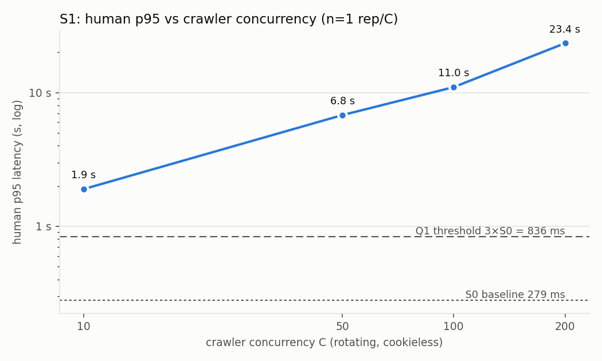
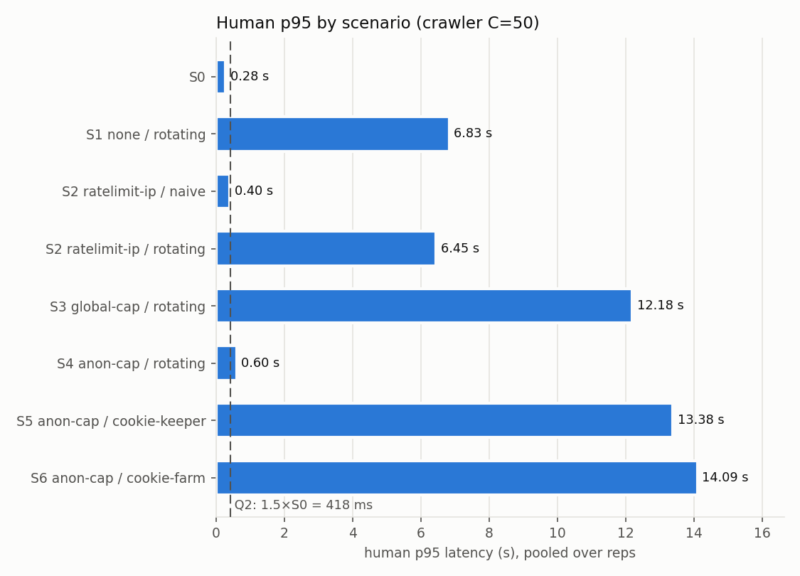
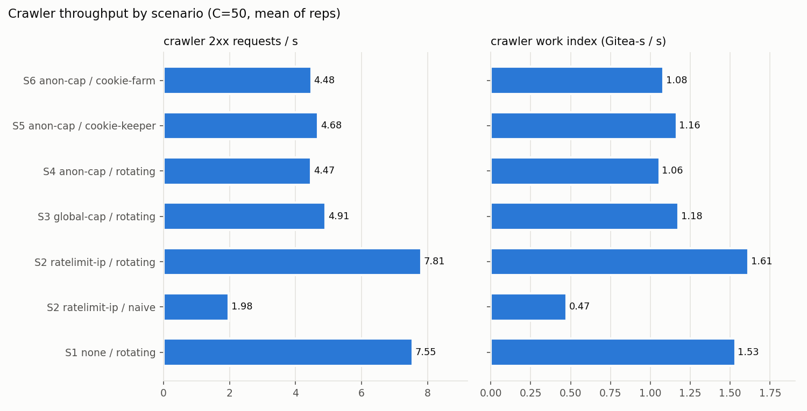

# FairQueue PoC

Spec: `FAIRQUEUE_POC.md`. Decisions and deviations: [DECISIONS.md](DECISIONS.md).

Questions:
- **Q1.** When crawlers pile onto a local Gitea, does human p95 get noticeably worse?
- **Q2.** Does a simple cap on concurrent anonymous (cookieless) requests restore human latency?
- **Q3.** Does that cap break once crawlers keep a cookie, or farm many cookies?

## Environment

| item | value |
|---|---|
| host | Windows 11, 16 logical CPUs, 31 GB RAM |
| WSL2 VM | 12 vCPU, 16 GB (`.wslconfig`), kernel 6.6.87.2-microsoft-standard-WSL2 |
| Docker | Docker Desktop, Engine 29.1.3, cgroup v2 |
| Gitea | `gitea/gitea:1.27.3`, sqlite3, default cache, **session provider = memory** (life 86400 s, GC 86400 s) |
| Gitea limits | cpuset 2-3, `cpus: 2`, 2 GiB memory, swap off |
| gateway | Go 1.25 `httputil.ReverseProxy`, cpuset 4-5 |
| human sim | Python 3.12 asyncio + httpx 0.28.1, cpuset 6 |
| crawler | cpuset 7-10 |
| tools / monitor | cpuset 11 |
| unpinned | CPUs 0-1 (VM / dockerd overhead) |

Gitea settings that differ from image defaults:
- `INSTALL_LOCK=true`
- `ROOT_URL=http://gitea:3000/`
- `DISABLE_SSH=true`
- `DISABLE_REGISTRATION=true`

Gitea is restarted before every run, which clears its in-memory caches and sessions.

## Reproduce

```sh
make stage1                    # seed redis/redis, build URL pools, cost table
sh scripts/run.sh S0 1         # one run: MODE=none, no crawler
make s0                        # S0 x3
make s1-sweep                  # S1 rotating, C = 10/50/100/200 (C = 2/5 and extra reps via scripts/run.sh)
make stage4                    # S2 (naive + rotating), S3, S4 x3 at C=50
make stage5                    # S5 (cookie-keeper), S6 (cookie-farm) x3 at C=50
```

Each run writes `results/runs/<run_id>/`:

| file | contents |
|---|---|
| `human.csv` | every human request |
| `monitor.csv` | 1 s cgroup samples of gitea, gateway, human and crawler |
| `timeline.csv` | gitea CPU, memory and cumulative sessions per second |
| `summary.json` | per-run summary |
| `meta.json` | run parameters |
| `raw/gateway.jsonl` | gateway log (not committed) |

## Data

- redis/redis, `unstable` @ `20bb2cf`.
  - 13,304 commits (9,966 first-parent), 115 branches, 415 tags.
- URL pools (`urlpool/`, seed 42):

| pool | size |
|---|---|
| src | 1,871 |
| commits pages | 267 |
| commit | 13,304 |
| blame | 20,000 |
| compare | 9,916 (distance 1–50) |

## Stage 1 — single-request cost per route type

Requests were sequential and cookieless, with 30 distinct URLs per type, after a Gitea restart. The run was done twice (r1, r2) with the same URL set. Times are in ms. Regenerate with `python analysis/cost_table.py`.

| type | n | median r1 | median r2 | pooled median | pooled p95 | max | mean size | × home | × commits |
|---|---|---|---|---|---|---|---|---|---|
| home | 60 | 12.5 | 12.2 | 12.4 | 21.4 | 72.4 | 68 KB | 1.0 | 0.38 |
| src | 60 | 34.2 | 28.4 | 32.1 | 118.1 | 135.5 | 187 KB | 2.6 | 0.99 |
| commits | 60 | 33.2 | 32.5 | 32.5 | 51.1 | 70.6 | 208 KB | 2.6 | 1.00 |
| commit | 60 | 78.9 | 82.7 | 82.7 | 749.4 | 1218.9 | 196 KB | 6.7 | 2.54 |
| blame | 60 | 171.6 | 156.2 | 163.4 | 1306.2 | 1902.3 | 3096 KB | 13.2 | 5.02 |
| compare | 60 | 1550.1 | 1522.2 | 1543.8 | 2783.8 | 3221.4 | 2366 KB | 125.0 | 47.43 |

How to read the two multiples:
- **× home** overstates the spread. home has only one URL, so it was requested 30 times and served warm.
- **× commits** is the conservative baseline. It uses 30 distinct pages, so there are no per-URL cache hits. Branch-level shared caches, such as the commit count, may still apply.
  - Even on this baseline, compare is **~47×** and blame **~5×** the cost of a commits page.
  - commit and blame have heavy tails: p95 is about 9× their median.

## Stage 2 — baseline (S0)

Gateway `MODE=none`, no crawler. The human load is open-loop Poisson at 3 req/s: 10 users, each with its own cookie and XFF. Each run is 30 s warmup + 180 s measurement, repeated 3 times. Latency is measured from the scheduled send time. Aggregated in `results/summary.csv`.

| | n | p50 | p95 | p99 | fail rate |
|---|---|---|---|---|---|
| **S0 pooled (3 reps)** | 1,680 | 46.0 ms | **278.8 ms** | 661.6 ms | 0 % |
| per rep | 558 / 549 / 573 | 44.2 / 48.3 / 44.8 | 270.6 / 267.4 / 298.8 | 550.7 / 758.1 / 528.6 | 0 / 0 / 0 |

Human p95 by route, per rep (ms):

| route | r1 | r2 | r3 |
|---|---|---|---|
| home | 28 | 47 | 44 |
| src | 110 | 84 | 104 |
| commits | 86 | 91 | 97 |
| commit | 422 | 656 | 499 |

Overall p95 is driven by the heavy tail of the `commit` route, which is consistent with the stage 1 cost table.

Resources during the measure window (per rep):

| | r1 | r2 | r3 |
|---|---|---|---|
| gitea CPU mean (% of 1 core; limit 200) | 23.6 | 29.3 | 27.4 |
| gitea CPU PSI "some" mean | 1.2 % | 1.4 % | 1.4 % |
| gitea memory start → peak | 93 → 194 MB | 98 → 233 MB | 93 → 213 MB |
| peak / 2 GiB limit | 9.5 % | 11.4 % | 10.4 % |
| memory PSI max / memory.events max / oom_kill | 0 / 0 / 0 | 0 / 0 / 0 | 0 / 0 / 0 |
| sessions created (live) | 10 | 10 | 10 |
| memory bottleneck | no | no | no |

Sanity checks:
- The generator is not lagging: send-lag p99 is ≤ 2.9 ms.
- Load-generator containers are not saturated: gateway CPU p95 ≈ 2 %, human CPU p95 ≈ 2 %.
- The gateway adds nothing measurable: `wait_ms` max is 0.09 ms. Client-side p50 minus gateway upstream p50 is ≈ 5 ms, which includes the Python client and one extra hop.
- Sessions: exactly one per user (10), so humans reuse their cookies as intended.

**Q1 threshold derived from S0:** S1 counts as a success when human p95 ≥ 3 × 278.8 ≈ **836 ms**.

## Stage 3 — crawler load, no protection (S1) → Q1

Setup:
- Gateway `MODE=none`.
- Crawler is **rotating** (a fresh random XFF per request, outside 10.0.0.0/24) and stores no cookies.
- URL mix: commit 50 / blame 25 / src 15 / compare 10.
- C = 2/5/10/50/100/200. **C=50 has 3 reps; every other C has 1.**
  - Commits: `e278cde` for C = 10/50 r1/100/200, `bc5b6a6` for C = 2/5 and C=50 r2/r3. The difference between them is analysis code only.
- Human load is the same as S0 (unprimed; see DECISIONS.md).
- Tables come from `python analysis/sweep_table.py S1`.

Per C (median of reps):

| C | reps | human p95 | ×S0 | crawler 2xx/s | work index | gitea CPU mean | mem peak | marks |
|---|---|---|---|---|---|---|---|---|
| 2 | 1 | 613 ms | 2.2 | 4.71 | 1.183 | 185 % | 347 MB | degradation onset (≥ 1.5×S0) |
| 5 | 1 | 1.03 s | 3.7 | 5.51 | 1.331 | 182 % | 411 MB | |
| 10 | 1 | 1.90 s | 6.8 | 5.91 | 1.378 | 183 % | 554 MB | ◀ throughput knee |
| 50 | 3 | 6.78 s | 24.3 | 7.43 | 1.507 | 183 % | 952 MB | plateau |
| 100 | 1 | 10.99 s | 39.4 | 8.78 | 1.526 | 184 % | 1,371 MB | plateau |
| 200 | 1 | 23.41 s | 84.0 | 9.87 | 1.415 | 184 % | **1,972 MB (96 %)** | ↓ work declining, **memory bottleneck** |

Per run:

| C | rep | human p50 | human p95 | human p99 | human fail | crawler 2xx/s | compare share of 2xx | work index | crawler aborted | CPU PSI | mem peak (of 2 GiB) | sessions (measure) |
|---|---|---|---|---|---|---|---|---|---|---|---|---|
| 2 | 1 | 140 ms | 613 ms | 1.20 s | 0 % | 4.71 | 10.6 % | 1.183 | 2 | 16 % | 347 MB (17 %) | 847 |
| 5 | 1 | 304 ms | 1.03 s | 2.21 s | 0 % | 5.51 | 10.0 % | 1.331 | 4 | 23 % | 411 MB (20 %) | 991 |
| 10 | 1 | 535 ms | 1.90 s | 3.36 s | 0 % | 5.91 | 9.4 % | 1.378 | 5 | 26 % | 554 MB (27 %) | 1,064 |
| 50 | 1 | 2.63 s | 6.78 s | 9.28 s | 0.2 % | 7.43 | 7.3 % | 1.507 | 58 | 32 % | 952 MB (47 %) | 1,337 |
| 50 | 2 | 2.19 s | 6.61 s | 13.71 s | 0.4 % | 7.92 | 7.6 % | 1.646 | 72 | 30 % | 926 MB (45 %) | 1,425 |
| 50 | 3 | 2.42 s | 7.00 s | 10.65 s | 0 % | 7.31 | 7.0 % | 1.443 | 63 | 31 % | 895 MB (44 %) | 1,315 |
| 100 | 1 | 4.65 s | 10.99 s | 19.14 s | 0.4 % | 8.78 | 5.2 % | 1.526 | 157 | 37 % | 1,371 MB (67 %) | 1,581 |
| 200 | 1 | 11.72 s | 23.41 s | 29.99 s† | 0.5 % | 9.87 | 3.3 % | 1.415 | 333 | 40 % | 1,972 MB (96 %) | 1,777 |

S1 at C=50, pooled over 3 reps: human p95 **6.83 s (24.5× S0)**. The per-rep p95s are 6.78 / 6.61 / 7.00 s.

† At or near the 30 s client timeout. Human latencies are right-censored at 30 s, so p99 at C=200 is a lower bound.



### Q1 verdict: **reproduced**
- Even at the lowest C tested (C=2), human p95 is 2.2× S0.
- The spec's 3× threshold (836 ms) is crossed from C=5 (3.7×) onward, and C=200 reaches 84×.
- At C=50, the three reps agree within ±3 %.
- Failures stay low (≤ 0.5 %, all 30 s timeouts): humans are not refused, they wait.

### Where throughput bends
- **CPU saturates already at C=2.** Gitea runs at 182–185 % of its 200 % limit at every C. CPU PSI "some" rises from 16 % to 40 %, meaning tasks increasingly wait for CPU.
- **Raw crawler 2xx/s keeps rising (4.7 → 9.9), but that is mix shift, not extra capacity.**
  - Under overload the most expensive requests (compare, ~47× a commits page) hit the crawler's 30 s timeout first.
  - compare falls from 10.6 % to 3.3 % of successes, and cheap requests fill the freed slots.
- **The work index is the better measure.** It weights each success by its stage-1 unit cost, giving seconds of Gitea work per second.
  - Gains between successive C values: +13 % (2→5), +3.5 % (5→10), +9 % (10→50, median), +1 % (50→100), −7 % (100→200).
  - By the < 10 % rule, the **knee is at C≈10**.
  - Beyond it, extra concurrency buys little or no work. It adds queueing delay for humans and wasted work on aborted requests (333 aborted at C=200).
  - The first 1-rep sweep without C=2/5 had put the knee at C=50. See DECISIONS.md.

### Memory and sessions
- **Memory tracks in-flight concurrency, not accumulated sessions.**
  - At C=10, Gitea sits at 300–380 MB the whole run while sessions grow 92 → 1,283.
  - At every C, memory drops as soon as load stops.
  - Peak memory scales with C: 554 → 952 → 1,371 → 1,972 MB.
- Sessions: every successful cookieless crawler response creates one memory session (sessions in the window ≈ crawler 2xx count). This amounts to ~2,300 sessions per run at C=200, with no visible memory cost at this scale.
- **C=200 is memory-bound as well as CPU-bound.** Peak memory.current reached **96.3 % of the 2 GiB limit**, which triggers the memory-bottleneck rule.
  - Memory PSI stayed at 0 and `memory.events max`/oom_kill at 0, so no reclaim stall was observed yet. The container was nonetheless at the edge.
  - The work-index drop at C=200 should therefore not be attributed to CPU alone.
  - **Results at C=200 must be read as a combined CPU and memory limit.** C ≤ 100 is CPU-bound only.

## Stage 4 — simple defences (S2–S4) → Q2

Setup:
- Crawler C = 50, 3 reps per scenario, commit `62788e0`.
- Human load is as in S0, but users are **primed returning visitors**: each holds its session cookie before t0 (DECISIONS.md).
- Gateway parameters (rationale in DECISIONS.md):
  - `ratelimit-ip`: 2 req/s per IP, burst 2
  - `global-cap`: N = 4
  - `anon-cap`: anonymous N = 2, cookie M = 4
- All FIFO waits are capped at 30 s. Crawlers back off 1 s on 429/503.
- Tables come from `python analysis/scenario_table.py`.

| scenario | human p50 | human p95 | ×S0 | human p99 | human fail | p95 per rep | human gw wait p95 | crawler 2xx/s | work index (vs S1) | gitea CPU | mem peak |
|---|---|---|---|---|---|---|---|---|---|---|---|
| S0 (no crawler) | 46 ms | **279 ms** | 1.00 | 662 ms | 0 % | 271 / 267 / 299 | 0 | – | – | 27 % | 233 MB |
| S1 none / rotating | 2.42 s | **6.83 s** | 24.5 | 10.86 s | 0.2 % | 6784 / 6609 / 7000 | 0 | 7.55 | 1.53 (100 %) | 183 % | 952 MB |
| S2 ratelimit-ip / naive | 63 ms | **404 ms** | 1.45 | 987 ms | **1.4 % (429)** | 407 / 393 / 401 | 0 | 1.98 | 0.48 (31 %) | 95 % | 351 MB |
| S2 ratelimit-ip / rotating | 2.24 s | **6.45 s** | 23.1 | 11.03 s | **1.6 % (429)** | 6610 / 6232 / 6292 | 0 | 7.81 | 1.61 (105 %) | 183 % | 1,000 MB |
| S3 global-cap / rotating | 9.31 s | **12.18 s** | 43.7 | 13.45 s | 0 % | 12640 / 12003 / 11937 | 12.4 s | 4.91 | 1.18 (77 %) | 185 % | 456 MB |
| S4 anon-cap / rotating | 140 ms | **596 ms** | **2.14** | 1.39 s | 0 % | 563 / 561 / 647 | 0 | 4.47 | 1.06 (69 %) | 186 % | 386 MB |

No run in stage 4 hit the memory-bottleneck rule. The maximum was 49 % of the limit.




### S2: the per-IP rate limit
- **Against a fixed IP (naive) it works.**
  - Human p95 drops to 404 ms (1.45×).
  - The crawler is held to ≈ 2 successful req/s. It gets about 8,800 429s per run and 31 % of S1's work.
- **Against rotating IPs it does nothing.** Human p95 is 6.45 s (23×), and the crawler keeps 105 % of its S1 work, because every request comes from a fresh IP.
- **It also rejects humans: 1.4–1.6 % of human requests got 429.**
  - Each human averages only ≈ 0.3 req/s. Open-loop (Poisson) arrivals nonetheless occasionally put 3 requests from one user inside a second, which empties a burst-2 bucket.
  - A real browser, which fetches assets in bursts, would be hit harder.

### S3: global cap (N=4, one shared FIFO)
- **It is worse for humans than doing nothing:** p95 12.2 s vs 6.8 s.
  - Human requests wait in the same FIFO as ~46 queued crawler requests (gateway wait p95 12.4 s).
  - Once admitted, they are fast: upstream p95 is ~0.6 s.
- The cap protects Gitea itself. Memory is 456 MB vs 952 MB, and CPU stays saturated (185 %), so N=4 did not starve it.
- Crawler work falls to 77 % of S1 at equal CPU. This run design does not isolate why.

### S4: anonymous cap (anon N=2, cookie M=4)
- **Human p95 falls from 6.83 s to 0.60 s** (24.5× → 2.14× S0), with 0 human failures. The three reps agree (561–647 ms).
- Humans wait **0 ms** at the gateway (p95), because they never share a queue with crawlers.
  - The remaining excess over S0 is inside Gitea: two crawler requests are always in flight on its 2 cores.
  - CPU stays at 186 % and CPU PSI at ~16 %, vs 1.3 % in S0.
  - Human `commit` p95 is 1.1–1.5 s vs ~0.5 s in S0: heavy human pages compete for the same CPU.
- Crawlers are **throttled, not blocked**.
  - 0 × 503. Every crawler request is eventually served after a gateway wait of p50 ≈ 9.7–10.3 s.
  - Crawlers keep 59 % of S1's 2xx/s and **69 % of its work index**.

### Q2 verdict
**By the spec's criterion (S4 human p95 ≤ 1.5× S0 = 418 ms), Q2 is not met.** S4 reached 596 ms (2.14×) in all three reps (≥ 2.0× each).

Relative to the unprotected case, the simple cookieless cap removes **~95 % of the excess human p95** ((6825 − 596) / (6825 − 279)). It does so without refusing any crawler request, while keeping ~69 % of crawler work. None of the other simple defences comes close:
- The IP rate limit fails against rotation and hurts humans.
- The global cap makes humans wait behind crawlers.

The residual 2× is CPU contention inside Gitea from the crawlers' two in-flight slots, not queueing. A smaller anon N (1) would likely trade crawler throughput for human latency, but that is **untested**.

The spec's reading: if the simple fix largely works, Q3 decides the case. Here it largely works, though not to the 1.5× line. **Q3 (cookie-keeper / cookie-farm through the cookie pool) is therefore the deciding experiment.**

## Stage 5 — crawlers that keep cookies (S5, S6) → Q3

Setup:
- `anon-cap` with anon N = 2 and cookie M = 4, the same as S4. Crawler C = 50, 3 reps each, commit `4eb5e10`. Humans are primed, as in S4.
- **cookie-keeper (S5):** gets 1 session cookie through the gateway at the start and uses it on every request from all 50 workers.
- **cookie-farm (S6):** gets 100 cookies and round-robins them.
- Both keep rotating their XFF.
- Slot occupancy comes from the gateway log (DECISIONS.md). Tables come from `python analysis/scenario_table.py`.

| scenario | human p50 | human p95 | ×S0 | human p99 | human fail | p95 per rep | human gw wait p95 | cookie slots: crawler share of used | cookie slots held, human / crawler (of M=4) | crawler 2xx/s | work index | sessions |
|---|---|---|---|---|---|---|---|---|---|---|---|---|
| S0 | 46 ms | **279 ms** | 1.00 | 662 ms | 0 % | 271 / 267 / 299 | 0 | – | – | – | – | 10 |
| S1 none / rotating | 2.42 s | **6.83 s** | 24.5 | 10.86 s | 0.2 % | 6784 / 6609 / 7000 | 0 | – | – | 7.55 | 1.53 | 1,761 |
| S4 anon-cap / rotating | 140 ms | **596 ms** | 2.14 | 1.39 s | 0 % | 563 / 561 / 647 | **0** | **0 %** | 16 % / 0 % | 4.47 | 1.06 | 1,018 |
| S5 anon-cap / cookie-keeper | 9.76 s | **13.38 s** | **48.0** | 14.35 s | 0 % | 12453 / 13204 / 13687 | 13.4 s | **83 %** | 17 % / 83 % | 4.68 | 1.16 | **1** |
| S6 anon-cap / cookie-farm | 10.06 s | **14.09 s** | **50.6** | 15.05 s | 0 % | 12300 / 14467 / 14362 | 14.3 s | **82 %** | 18 % / 82 % | 4.48 | 1.08 | **100** |

Other observations:
- Gitea CPU was 185 % in both S5 and S6.
- CPU PSI was ≈ 22 % (S4: ≈ 16 %).
- Memory peaked at 491 MB (24 %). There was no memory bottleneck.
- In both S5 and S6 the anon pool sat empty (0 % crawler occupancy), because every crawler request moved into the cookie pool.

Per-rep cookie-pool detail (from `summary.json → slot_occupancy.cookie`):

| run | human wait p50 / p95 | crawler wait p50 | human upstream p95 | crawler share of used |
|---|---|---|---|---|
| S5 r1 | 8.9 / 12.3 s | 8.6 s | 605 ms | 84.6 % |
| S5 r2 | 9.8 / 12.6 s | 9.3 s | 588 ms | 82.4 % |
| S5 r3 | 10.1 / 13.4 s | 10.1 s | 727 ms | 81.9 % |
| S6 r1 | 8.6 / 12.0 s | 8.2 s | 642 ms | 84.1 % |
| S6 r2 | 10.4 / 14.3 s | 10.3 s | 675 ms | 80.5 % |
| S6 r3 | 10.0 / 14.0 s | 9.9 s | 794 ms | 81.7 % |

### What happens
- **One cookie is enough.** A crawler holding a single session cookie (S5) moves all of its traffic from the 2-slot anon pool into the 4-slot cookie pool.
- There it takes **80–85 % of the slot-seconds** and pushes humans into the same FIFO.
  - Human and crawler waits are nearly identical (p50 ≈ 9–10 s each), which is what a shared FIFO does.
  - Once admitted, human requests are fast again (upstream p95 0.6–0.8 s).
  - The human share of slot-seconds (17–18 %) is about what humans used in S4 (16 %). Humans get the same amount of service, but only after queueing behind ~46 crawler requests.
- **Human p95 becomes worse than no protection at all**: 13.4–14.1 s vs S1's 6.8 s.
  - The outcome now matches S3 (global cap, 12.2 s). The cookie pool has effectively become a global cap that the crawler shares with humans.
- **The crawler loses nothing by keeping a cookie.** Its work index is 1.08–1.16, equal to or above its S4 value (1.06). The cookie pool has more slots than the anon pool.
- **Farming 100 cookies (S6) gives the same result as keeping 1 (S5).** The difference is within rep-to-rep noise. Under `anon-cap`, the number of sessions a crawler holds is irrelevant: only "has a cookie" matters.
- Humans see no failures: every wait stayed under the 30 s cap.

### Q3 verdict: **the simple fix collapses**
- With one kept cookie, the S4 defence goes from 2.1× S0 to **48× S0** (S5), and to 51× with a cookie farm (S6).
- All three reps of each scenario are ≥ 44×.
- That is worse than having no defence (24.5×).
- Mechanism: under `anon-cap`, the cookie flag is the only thing separating crawlers from humans. Anyone can obtain a cookie for free with a single request, so the flag no longer separates them.

This meets the spec's condition for the topic's rationale:
- A cookie alone is not enough to tell humans from crawlers.
- Protecting humans requires scheduling that accounts for how much each principal consumes. In this data a single session held 83 % of the protected slots.
- Per-session limits alone would not close the gap either: the S6 farm spreads the same load over 100 sessions (≈ 1 % of the requests each).

## Known limitations

- `X-Forwarded-For` only simulates IP rotation. The requests do not come from different network paths.
- Everything runs on a single machine, so network latency is negligible.
- The human simulator is not a browser. It skips static assets.
- Cookie presence is judged by the cookie name only. A fabricated `i_like_gitea` value would pass.
- Human latency is right-censored by the 30 s client timeout. Percentiles near 30 s are lower bounds.
- The work index uses unloaded single-request medians as unit costs. It is an estimate of work done, not a measured CPU-time split.
- **First-time visitors go through the anonymous queue under `anon-cap`.**
  - A human with no session cookie yet (a first visit, or cookies cleared or expired) is indistinguishable from a cookieless crawler. That human's first request, and every request sent before the cookie arrives, waits in the anon pool behind the crawlers.
  - In the stage 4 smoke test with unprimed users, only 61 % of human requests carried a cookie. Gateway wait p95 was ≈ 10 s, and a 503 there (no Set-Cookie) left a user cookieless indefinitely.
  - The S2–S6 measurements prime every user (returning visitors), so **they do not measure the first-visit experience**, which under anon-cap is as bad as the crawler queue.
- S0/S1 humans were unprimed (cookie obtained on the first request), while S2 onward are primed. The measure windows are comparable: every S0/S1 user had its cookie within the warmup.
- Stage 4 used a single parameter set per mode (no N/M sweep). The Q2 verdict holds for anon N=2 / M=4 only.
- The session provider is memory. Every cookieless request creates a server-side session that lives 24 h, so a cookieless crawler also grows Gitea's heap.
